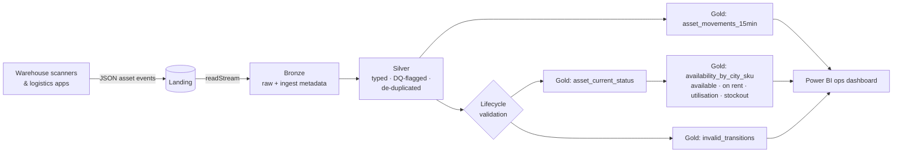
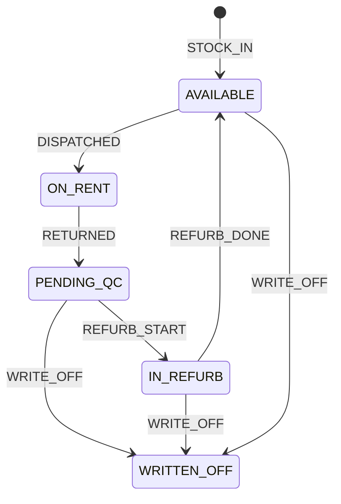

# Real-Time Rental Asset & Inventory Tracking

**Inspired by my work at Furlenco** · PySpark Structured Streaming · Medallion architecture · Microsoft Fabric-ready

In a rental business, every physical asset (each TV, washing machine or treadmill) cycles through **stock → dispatched to a customer → returned → refurbished → available again** across city warehouses. This project tracks that lifecycle in near real time, so operations always know **what is rentable right now, where, and how hard the fleet is working**.

> **Independent portfolio project.** It recreates the *kind* of real-time pipeline I built at Furlenco, from scratch, with **synthetic data**. It contains no Furlenco code, data, schemas or business logic and is not affiliated with Furlenco.

---

## Architecture



## Asset lifecycle



Events that break this lifecycle (for example an asset **dispatched twice** without a return) are caught by `validate_transitions`. They're routed to `invalid_transitions` for the ops team and excluded from the current-status table, so availability numbers stay trustworthy.

## Gold outputs

| Table | Answers | Refresh |
|---|---|---|
| `asset_current_status` | Where is asset X and what state is it in? | every micro-batch |
| `availability_by_city_sku` | How many units are rentable per city/SKU? Utilisation %? Stock-outs? | every micro-batch |
| `asset_movements_15min` | Dispatches / returns / refurb flow per city in 15-min windows | streaming append |
| `invalid_transitions` | Which scans are impossible and need investigation? | every micro-batch |

## Data quality

- **Duplicates:** `dropDuplicatesWithinWatermark(event_id)` handles at-least-once delivery with bounded state.
- **Flags, not drops:** `MISSING_ASSET`, `MISSING_WAREHOUSE` and `UNKNOWN_EVENT` stay in Silver for reconciliation.
- **Lifecycle rules:** status changes are checked against the state machine above.
- **Late data:** a 30-minute watermark on event time.

## Run it

```bash
pip install -r requirements.txt
export PYTHONPATH=src
python -m asset_tracking.generator --out data/landing --assets 500 --files 10
python -m asset_tracking.pipeline --landing data/landing --lake data/lake --once
pytest -q
```

On **Microsoft Fabric**, see [docs/fabric.md](docs/fabric.md). In short: the landing zone becomes a Lakehouse folder or Eventstream, tables are Delta, and Gold feeds a Direct Lake Power BI model.

## Tech

Python · PySpark Structured Streaming · Spark SQL · window functions · state-machine validation · Delta Lake / Microsoft Fabric · pytest · GitHub Actions
