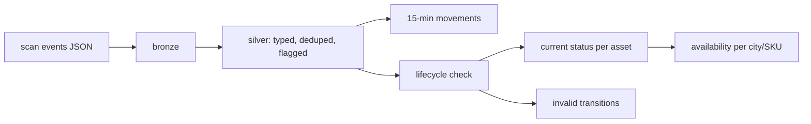

# rental-asset-tracking-realtime

Streaming pipeline that tracks rental assets (TVs, washing machines, treadmills etc.) as they move between warehouses and customers, and keeps a live view of what's actually available to rent in each city.

At Furlenco I worked on real-time pipelines for this kind of problem. This repo is a simplified version with **made-up data**. No company code, data or schemas are in here.

## Why

With hourly or daily refreshes, the availability numbers ops look at are always a bit stale. An item gets returned at 11am, and nobody sees it as rentable until the evening refresh. The idea here is to keep asset status current from scan events as they come in.

## How it works



Every asset goes through roughly this cycle:

`STOCK_IN → AVAILABLE → DISPATCHED (on rent) → RETURNED → REFURB → AVAILABLE`, with `WRITE_OFF` possible after a return or during refurb.

Scanners do weird things in practice. The same event arrives twice, an asset gets "dispatched" while it's still with a customer, or the asset id is missing. So:

- duplicates are dropped with `dropDuplicatesWithinWatermark` on `event_id`
- rows with missing ids are kept in silver with a `dq_status` flag instead of being thrown away
- `validate_transitions` checks every event against the previous status of that asset, and anything impossible goes to `invalid_transitions` instead of messing up the availability numbers

Gold tables:

- `asset_current_status`: latest valid status per asset
- `availability_by_city_sku`: available / on rent / in refurb, utilisation %, stock-out flag
- `asset_movements_15min`: dispatches, returns etc. per city in 15-minute windows
- `invalid_transitions`: for ops to look at

## Running it

Needs Python 3.10+ and Java 17 for Spark.

```bash
pip install -r requirements.txt
export PYTHONPATH=src

python -m asset_tracking.generator --out data/landing --assets 500 --files 10
python -m asset_tracking.pipeline --landing data/landing --lake data/lake --once

pytest -q
```

The generator plants a few bad events on purpose (duplicates, missing ids, double dispatches) so the checks have something to catch.

On Fabric it's the same code with `--format delta`, writing to Lakehouse tables. There are some notes in [docs/fabric.md](docs/fabric.md).

## Known limitations / next steps

- `refresh_status` recomputes current status from the whole silver table each batch. Fine at this size, but for a real fleet I'd switch it to a Delta `MERGE` on `asset_id`.
- Late events older than the 30-minute watermark are dropped from the windowed counts.
- An alert on stock-outs (Fabric Activator or a Teams webhook) would be the obvious next addition.
